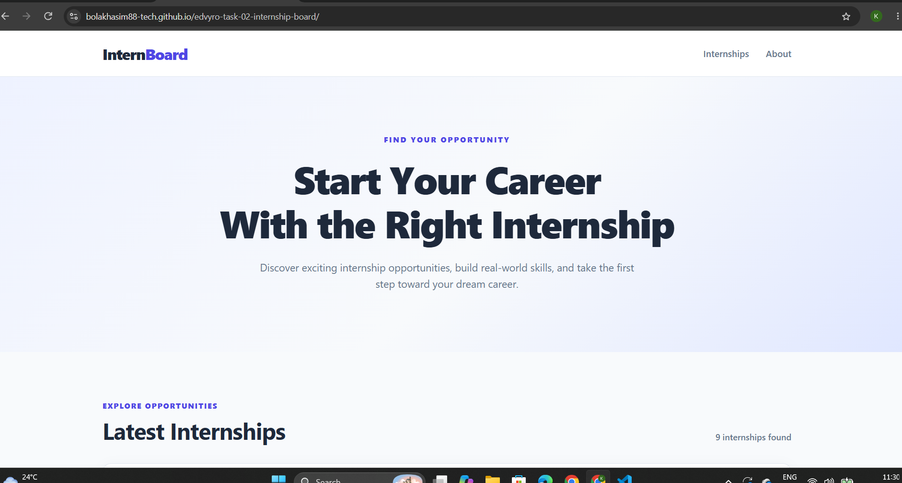
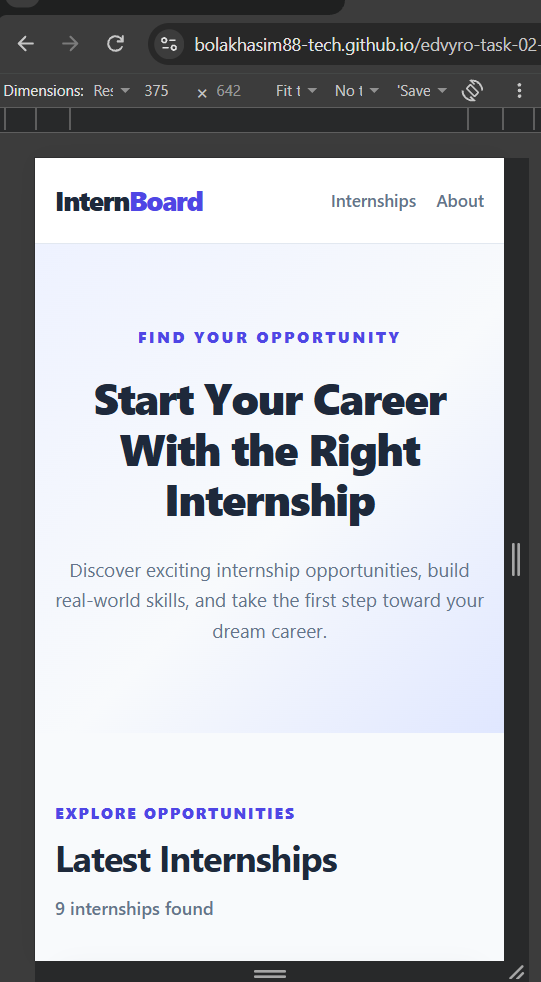

# edvyro-task-02-internship-board
Responsive Internship Board using HTML, CSS, and JavaScript
# Responsive Internship Board

## 📌 Project Overview

A responsive and accessible internship listing website built using HTML, CSS, and JavaScript.

This project helps students explore internship opportunities through a user-friendly interface. Users can search for internships and filter them by domain.

## 🎯 Objective

To practice semantic HTML, responsive CSS, DOM rendering, filtering, and accessible interactions without using a frontend framework.

## ✨ Features

- Responsive design for mobile, tablet, and desktop
- Internship listing cards
- Search internships by title or company
- Filter internships by domain
- Empty state when no internships are found
- Accessible form labels and keyboard interactions

## 🛠️ Technologies Used

- HTML5
- CSS3
- JavaScript
- GitHub Pages

## 📂 Project Structure

```text
Responsive-Internship-Board/
├── README.md
├── index.html
├── style.css
├── script.js
└── screenshots/
    ├── desktop.png
    └── mobile.png
```

## 🚀 Live Demo

[Open Internship Board](https://bolakhasim88-tech.github.io/edvyro-task-02-internship-board/)

## Screenshots

### Desktop View


### Mobile View


## 📚 Learning Outcomes

- Practiced semantic HTML
- Learned responsive web design
- Implemented search and filtering using JavaScript
- Practiced DOM manipulation
- Improved accessibility
- Deployed a website using GitHub Pages

## 👨‍💻 Author

Created as part of the EdVyro Full Stack Development Virtual Internship.

## 📄 Internship Task

**Task:** Responsive Internship Board  
**Program:** EdVyro Full Stack Development Virtual Internship
